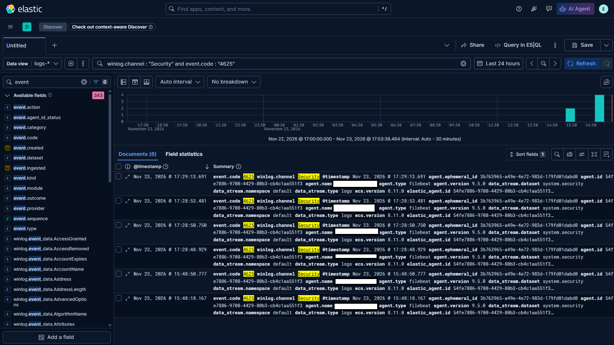
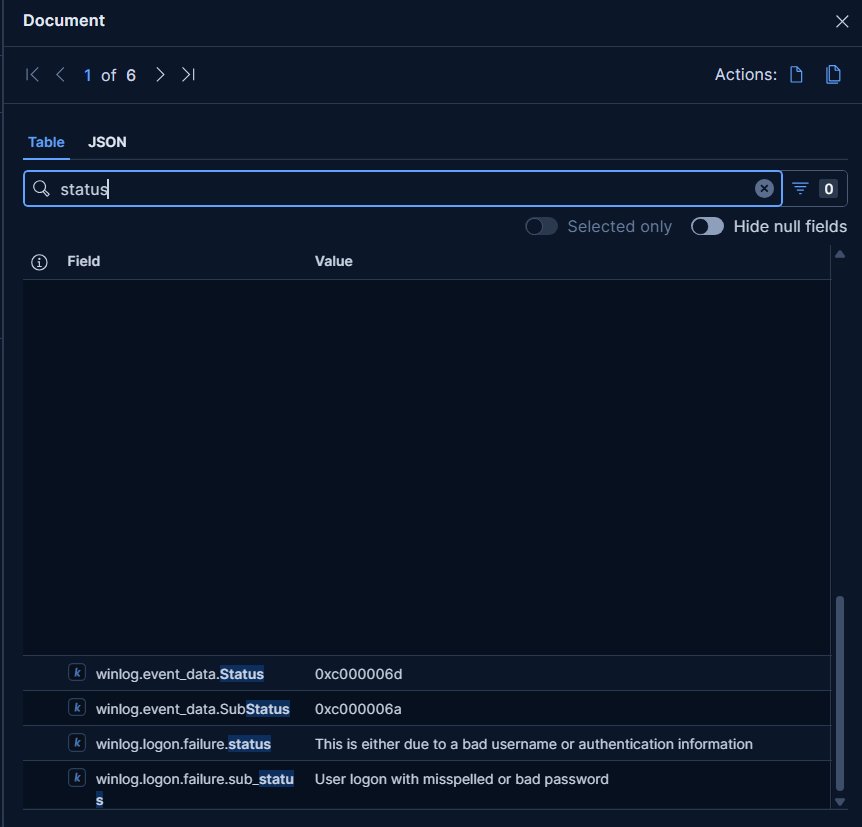
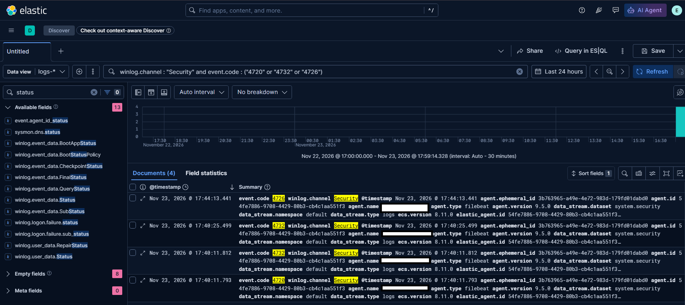
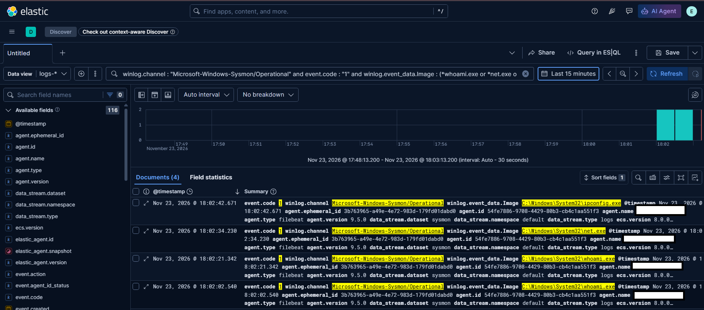
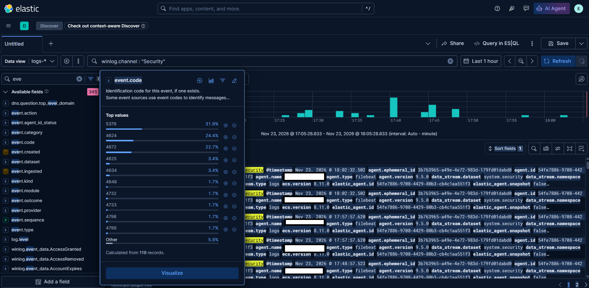

# Windows Authentication Log Investigation

I built this lab to practise what a SOC analyst does with Windows logs: take raw events, work out what happened, and write a verdict. I made the activity myself on my own lab VM, then investigated it in Kibana the way I would investigate a real alert.

It runs on the same lab as my [Sysmon telemetry project](https://github.com/shivank-001/sysmon-elastic-telemetry-lab).

## What's in the lab

- A Windows 10 VM (VMware) sending logs through Elastic Agent
- An Ubuntu VM running Elasticsearch, Kibana and Fleet Server
- Sysmon on the Windows VM, plus the Windows Security log

Everything is on my own laptop, isolated from any real network.

## Setup change I had to make

My agent only collected the Sysmon channel, and logon events (4624, 4625) live in the Security channel. I added the standard Windows integration in Fleet to get them.

That caused a problem: the new integration also collects Sysmon, so every Sysmon event arrived twice. I found it by checking `data_stream.dataset` in Discover, which showed two values (`sysmon` and `windows.sysmon_operational`). I switched Sysmon off in the Windows integration, and only `sysmon` came through after that. The duplicate would have ruined the counts from my first project.

## Events I looked at

| Event ID | Meaning |
|---|---|
| 4624 | Successful logon |
| 4625 | Failed logon |
| 4672 | Special privileges assigned to a new logon |
| 4720 | User account created |
| 4732 | Member added to a local group |
| 4726 | User account deleted |
| Sysmon 1 | Process created, with full command line |

---

## Investigation 1: Failed logons

**What I did:** locked the VM and typed a wrong password 4 times, then logged in correctly.

**Query:**
```
winlog.channel : "Security" and event.code : ("4625" or "4624")
```

**What the logs showed:**
- 4 failed logons (4625), matching the 4 attempts
- LogonType `2`, which is a keyboard logon at the machine
- Source IP `127.0.0.1`, so the attempts came from the machine itself
- Status `0xC000006D` and SubStatus `0xC000006A`

The SubStatus matters. `0xC000006A` means the username exists and the password was wrong. If it had been `0xC0000064`, the user would not exist, which points to someone guessing usernames.

**Verdict:** benign, my own test. A real attack over the network would show LogonType 3 or 10 and an outside IP address, not 127.0.0.1.




---

## Investigation 2: New admin account

**What I did:** created a local user and added it to Administrators, then deleted it.

**Query:**
```
winlog.channel : "Security" and event.code : ("4720" or "4732" or "4726")
```

**What the logs showed:**
- 4720: account created
- 4732: added to Administrators
- 4732 again: added to Users (Windows does this automatically for every new local account, so it is normal)
- 4726: account deleted
- The account that created it was my own lab user

**Verdict:** expected, since I did it. If I had not, an account created and made admin within seconds is a classic persistence pattern. The quick promotion is what makes it suspicious.

**MITRE ATT&CK:** T1136.001 (Create Account: Local Account), T1098 (Account Manipulation)



---

## Investigation 3: Discovery commands

**What I did:** ran `whoami /all`, `net user` and `ipconfig /all` in Command Prompt. These are the commands an attacker often runs first on a machine they have just landed on.

**Query:**
```
winlog.channel : "Microsoft-Windows-Sysmon/Operational" and event.code : "1" and winlog.event_data.Image : (*whoami.exe or *net.exe or *ipconfig.exe)
```

I used Sysmon Event 1 instead of Windows 4688 because Sysmon records the full command line by default. 4688 does not unless extra auditing is switched on.

**What the logs showed:** all three commands, with their arguments, the parent process and the user who ran them.

**Verdict:** benign, my own test. In a real case, the signal is several of these commands run close together by one process.

**MITRE ATT&CK:** T1033 (System Owner/User Discovery), T1087 (Account Discovery), T1016 (System Network Configuration Discovery)



---

## What the Security log looks like overall

A day of normal use on one Windows VM gave about 1,800 Security events. Most of them are not attacks:



- 4907 (audit settings changed) was the biggest share, which is background noise
- 4624 and 4672 are the logon events that matter for investigations
- 4625 was missing until I created failed logons myself

This is why filtering matters. Searching only `4624` returns dozens of system logons that have nothing to do with a person.

## Problems I hit

| Problem | Cause | Fix |
|---|---|---|
| Sysmon events doubled | Windows integration also collects Sysmon | Turned Sysmon off in the Windows integration |
| Search with the username returned nothing | Field values are case-sensitive | Searched on event code and logon type first, then narrowed |
| Security channel not visible in the integration list | UI list did not show it | Checked Discover directly and confirmed Security events were arriving |

## What I learned

- A failed logon is only meaningful with its Status and SubStatus codes
- LogonType and source IP tell you whether an attempt was local or remote
- Account creation followed by a group change is worth looking at every time
- Sysmon gives better process detail than the default Windows logs
- Filtering by event code first makes a noisy log usable

## Next steps

- Simulate a remote password-guessing attack from a Kali VM and compare LogonType 3 against what I saw here
- Turn these searches into detection rules (next project in this series)

## Tools

Windows 10, Sysmon, Elasticsearch, Kibana, Elastic Agent, Fleet, VMware Workstation
